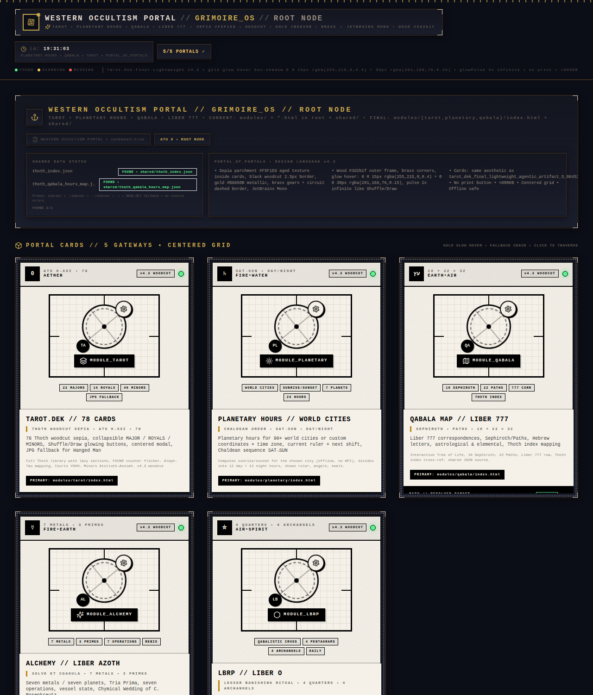
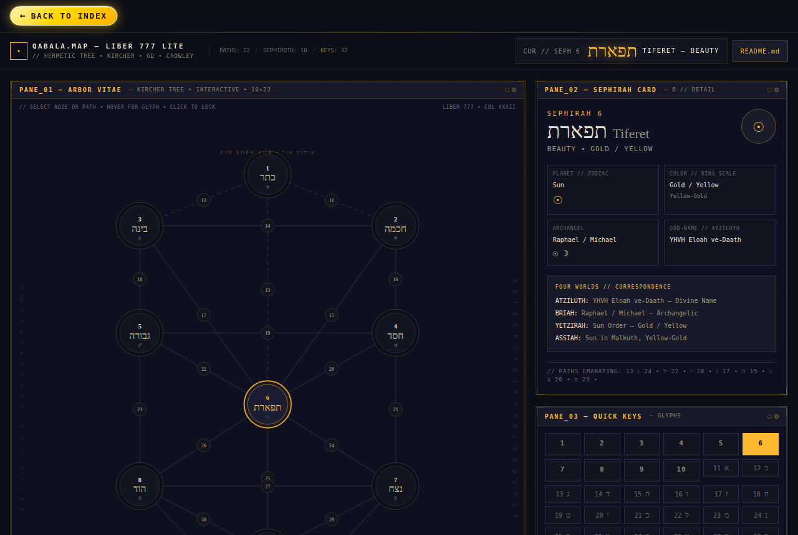
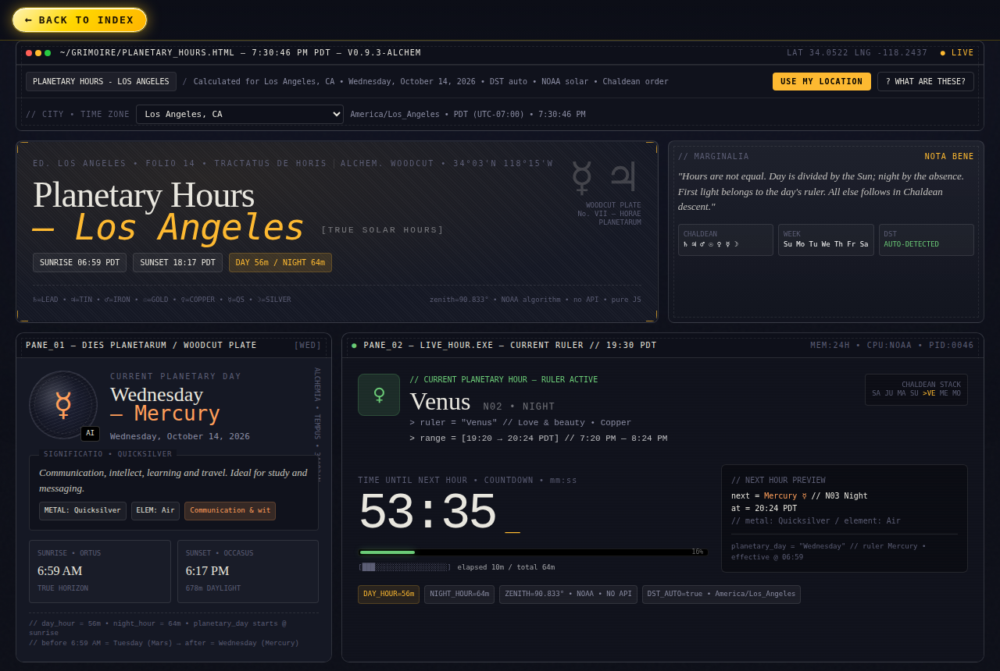
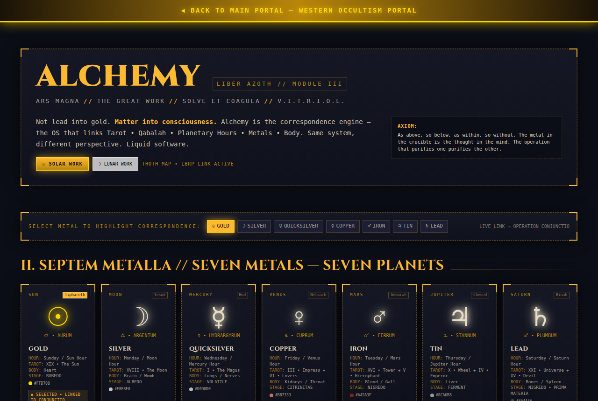
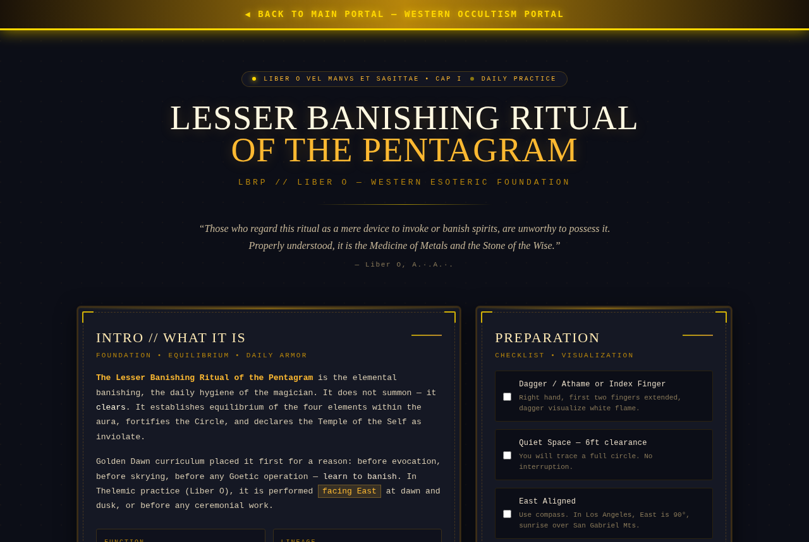
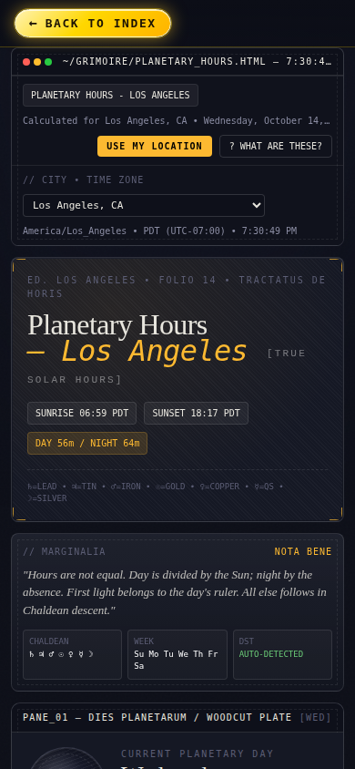

<div align="center">

# ☉ Western Occultism ☽

### *A pocket grimoire for the browser*

Tarot · Planetary Hours · Qabala · Alchemy · the LBRP, as interactive, woodcut-styled pages that run on your phone or laptop.


<br/>



*As above, so below. As within, so without.*

</div>

---

## ✦ The Modules

| | Module | What's inside |
|:-:|---|---|
| 🂠 | **[Tarot](modules/tarot/)**, *Tarot.Dek* | All 78 Thoth cards (22 Majors, 16 Royals, 40 Minors) with shuffle and a 3-card past/present/future draw. Collapsible sections, card modal, searchable by name or sigil. |
| ♄ | **[Planetary Hours](modules/planetary/)**, *Horae Planetarum* | The current planetary day and hour, a countdown to the next ruler, and all 24 unequal hours in Chaldean order. **Choose from 90+ world cities**, or enter your own coordinates and time zone. |
| עץ | **[Qabala](modules/qabala/)**, *Liber 777* | An interactive Tree of Life with 10 Sephiroth and 22 Paths. Hover for glyphs, click to see Hebrew letters, planets, King-scale colours, archangels and the four worlds. |
| ☿ | **[Alchemy](modules/alchemy/)**, *Liber Azoth* | The seven metals and seven planets, the Tria Prima, the seven operations from Calcinatio to Coagulatio, vessel state, and the Chymical Wedding of C. Rosenkreutz. |
| ⛤ | **[LBRP](modules/lbrp/)**, *Liber O* | A step-by-step guide to the Lesser Banishing Ritual of the Pentagram: the Qabalistic Cross, pentagrams at the four quarters, archangels, vibration and visualization cues, and a daily practice checklist. |

All modules start from the **portal** (`index.html`) and link back to it.

---

## ✦ Gallery

<table>
  <tr>
    <td width="50%"><br/><sub><b>Qabala</b>: the Tree of Life with Liber 777 correspondences</sub></td>
    <td width="50%"><br/><sub><b>Planetary Hours</b>: the live ruler and all 24 hours</sub></td>
  </tr>
  <tr>
    <td width="50%"><br/><sub><b>Alchemy</b>: seven metals, seven planets</sub></td>
    <td width="50%"><br/><sub><b>LBRP</b>: an interactive ritual guide</sub></td>
  </tr>
</table>

<div align="center">
  <br/>
  <sub>The planetary hours page on a phone, with the city picker.</sub>
</div>

---

## ✦ Quick Start

The site is plain static files, with no install and no build step.

```bash
git clone https://github.com/marblecube/western-occultism.git
cd western-occultism
python3 -m http.server 8000
```

Then open **<http://localhost:8000>** in your browser. To use it from your phone, connect it to the same Wi-Fi and open `http://<your-computer-ip>:8000`.

> [!NOTE]
> Serve the folder rather than double-clicking `index.html`. On `file://` URLs the browser blocks the small same-origin checks that the pages use to find each other.

It works on any static host as well, including GitHub Pages, Netlify and Cloudflare Pages. Point the host at the repo root.

---

## ✦ Planetary Hours: How the Clock Works

```
day  hour = (sunset − sunrise) / 12
night hour = (next sunrise − sunset) / 12
first hour after sunrise  →  ruler of the weekday
then descend in Chaldean order:  ♄ → ♃ → ♂ → ☉ → ♀ → ☿ → ☽ → ♄ …
```

- **Sunrise and sunset** are calculated in the browser with the NOAA solar algorithm. There is no API and no network call.
- **The selected city sets the time zone**, not your device. Pick Tokyo while you're sitting in Los Angeles and every time, weekday and ruler shown is Tokyo's. Daylight saving time comes from the browser's built-in time zone database.
- **Custom location**: enter a latitude, a longitude and any IANA time zone, for example `Europe/Paris`.
- **Choose my city** opens a searchable list of every built-in city. Cities that share this device's time zone are suggested first, and no location permission or network request is involved.
- Your choice is saved on the device, so it's still selected the next time you open the page.

---

## ✦ Project Structure

```
.
├── index.html                  ✦ Portal: the root node linking every module
├── modules/
│   ├── tarot/
│   │   ├── index.html          🂠 Thoth deck viewer
│   │   └── tarot_cards_images/ 78 card images (.webp)
│   ├── planetary/index.html    ♄ Planetary hours + city / time zone picker
│   ├── qabala/index.html       עץ Tree of Life · Liber 777
│   ├── alchemy/index.html      ☿ Liber Azoth
│   └── lbrp/index.html         ⛤ Lesser Banishing Ritual of the Pentagram
├── shared/
│   ├── thoth_index.json        Thoth card index
│   └── thoth_qabala_hours_map.json
└── docs/screenshots/           README images
```

Each module is a **single self-contained HTML file**: React, styles and data are all inline. You can open or copy any one of them on its own.

---

## ✦ Design Language

> Sepia parchment · black woodcut borders · brass corners · gold glow · JetBrains-style monospace,
> styled like a tiling window manager.

---

<div align="center">

<sub>A cultural and esoteric study tool, not scientific or astronomical advice. Sunrise and sunset times are approximate.</sub>

**93 · Do what thou wilt**

</div>
